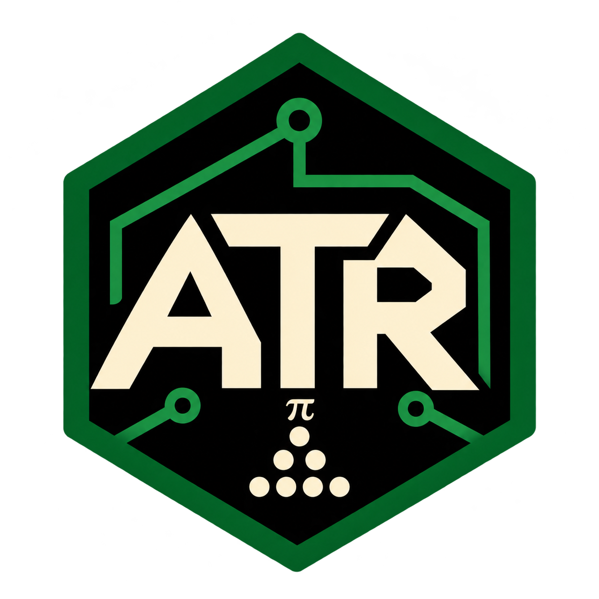

  

# Tlapohua

Juego de lógica aritmética para Android, con identidad visual inspirada en materiales y motivos mexicas. El jugador completa tableros respetando filas, columnas y operaciones de regiones.

Proyecto de portafolio en desarrollo. Esta entrega corresponde a la versión **0.31**, con código Java, herramientas de construcción en Python, catálogos y pruebas automatizadas.

## Funciones

- Juego libre con tableros de 2×2 a 9×9.
- Ruta del bosque con siete niveles y una opción casual.
- Reto diario con calendario y recuperación de fechas anteriores.
- Tutoriales, pistas graduadas, notas y números provisionales.
- Entrenamiento de concurso y torneo Cumbre de Turquesa con rangos locales.
- Prácticas por operación, retos cronometrados y seguimiento del aprendizaje.
- Cuaderno de errores, récords, reportes CSV y colección imprimible en PDF.
- Liga de amigos mediante archivos e intercambio Bluetooth.
- Respaldo y recuperación del progreso.
- Emblemas, animaciones, alto contraste y tablero ampliable.

Los catálogos clásicos y los de concurso tienen reglas propias. En concurso se permiten ambos órdenes de resta y división, y los números pueden repetirse dentro de una región si no comparten fila ni columna.

## Tecnologías

| Componente | Implementación |
|---|---|
| Aplicación | Java 8 y APIs nativas de Android |
| Interfaz y gráficos | Views, Canvas, Paint y animadores de Android |
| Construcción y auditorías | Python con bibliotecas estándar |
| Tableros | TSV y SQLite generado durante la construcción |
| Progreso | SharedPreferences, archivos propios y GZIP |
| Intercambio | Bluetooth Classic RFCOMM y selector de archivos de Android |
| Exportaciones | PdfDocument y CSV |
| Compilación | ECJ, AAPT2, D8, zipalign, apksigner y bundletool |

La compatibilidad mínima declarada es Android 6.0, API 23. La compilación y el objetivo usan API 36. El paquete es com.rey.celdas.

## Estructura

    .
    ├── README.md
    ├── .gitignore
    ├── docs/
    │   └── datos-para-Play-Console.md
    └── work/
        ├── build-celdas.py
        └── celdas/
            ├── AndroidManifest.xml
            ├── catalogo.tsv
            ├── concurso.tsv
            ├── concurso-clasicos.txt
            ├── finalistas.tsv
            ├── res/
            ├── src/com/rey/celdas/
            └── tests/

El código de la app está organizado en 24 archivos Java. MainActivity conecta la interfaz y los modos. Puzzle representa y valida tableros. ContestRun controla los torneos. Journey maneja la ruta. PracticeInsights prepara las recomendaciones. Las clases Progress gestionan el respaldo y su recuperación.

## Compilar en Windows

El script usa directamente las herramientas del SDK. Instala estas dependencias locales:

1. Python 3.9 o posterior.
2. Un JDK 17 completo, que incluya java, keytool y jarsigner.
3. Android SDK Platform 36 y Build Tools 36.0.0.
4. Eclipse ECJ 3.26.0, guardado como work/toolchain/ecj.jar.
5. bundletool 1.18.3, guardado como work/toolchain/bundletool-1.18.3.jar.

Puedes instalar las plataformas y herramientas desde el administrador del SDK de Android Studio o con las herramientas oficiales de línea de comandos. [Administrar el SDK](https://developer.android.com/tools/sdkmanager)

Descarga el compilador desde el artefacto org.eclipse.jdt:ecj:3.26.0 y bundletool desde su repositorio oficial. [ECJ](https://central.sonatype.com/artifact/org.eclipse.jdt/ecj/3.26.0) · [bundletool 1.18.3](https://github.com/google/bundletool/releases/tag/1.18.3)

En PowerShell, desde la raíz del proyecto, configura las rutas de tu equipo:

    $env:JAVA_HOME = 'C:/ruta/a/jdk-17'
    $env:ANDROID_SDK_ROOT = 'C:/ruta/a/Android/Sdk'
    python work/build-celdas.py

El script busca platforms/android-36/android.jar y build-tools/36.0.0 dentro de ANDROID_SDK_ROOT. También acepta ANDROID_HOME.

Para instalaciones con otra distribución de carpetas, puedes indicar las rutas completas mediante ANDROID_JAR, ANDROID_BUILD_TOOLS, ECJ_JAR y BUNDLETOOL_JAR. TLAPOHUA_TOOLCHAIN cambia la carpeta de búsqueda de los dos archivos JAR.

La construcción ejecuta las pruebas, prepara SQLite, compila Java, empaqueta los recursos, firma los resultados y valida el AAB. Los resultados aparecen en:

    outputs/Tlapohua-0.31.apk
    outputs/Tlapohua-0.31.aab

El proceso se detiene si encuentra un catálogo inválido o una prueba falla.

## Firma local

La primera compilación genera una clave de prueba en work/local-keys/tlapohua-local.jks, con alias tlapohua y la contraseña convencional de prueba android. La carpeta está excluida de Git.

Esta clave es propia de la copia local del proyecto. Para actualizar una instalación firmada anteriormente, se necesita su clave original. Conserva las claves originales en privado.

Para usar tu clave existente, configura TLAPOHUA_KEYSTORE, TLAPOHUA_KEY_ALIAS, TLAPOHUA_STOREPASS y, si difiere, TLAPOHUA_KEYPASS. Las contraseñas se proporcionan a las herramientas mediante variables de entorno. Define las credenciales en tu sesión local.

## Pruebas y auditoría

- PuzzleCheck comprueba reglas, solución única, tutoriales, ruta, calendario y generación de tableros.
- ContestCheck comprueba catálogos de concurso, puntuación, relojes, rangos y recomendaciones.
- FriendCheck comprueba el formato y el intercambio de fichas mediante flujos.
- ProgressCheck comprueba respaldos, versiones incompatibles, archivos dañados y recuperación ante una interrupción simulada.

La versión 0.31 contiene 391 tableros clásicos, incluidos tableros conservados para compatibilidad. El catálogo de concurso auditado reúne 200 tableros y hay 50 finales de 8×8. La compilación comprueba solución única según las reglas del modo correspondiente.

## Estado del proyecto

El APK y el AAB se generan en modo release. La compilación y las pruebas lógicas se han verificado en Windows. Las pruebas reales con TalkBack, texto ampliado, diferentes teléfonos y Bluetooth entre dos dispositivos siguen pendientes. La dificultad está organizada por tamaños y operaciones y requiere calibración con jugadores.

La preparación para Google Play incluye tareas pendientes de privacidad, contacto público y firma definitiva. Consulta docs/datos-para-Play-Console.md.

El desarrollo se realizó de forma iterativa con asistencia de IA para implementar funciones, revisar código y preparar pruebas.

## Uso en GitHub

Descomprime el proyecto y sube su contenido a tu repositorio. GitHub mostrará este README como presentación. Los directorios outputs, work/toolchain, work/celdas/build y work/local-keys contienen archivos locales generados o dependencias y están excluidos mediante .gitignore.

La licencia del código y las condiciones de reutilización del logo ATR quedan pendientes de la decisión del titular del proyecto.
